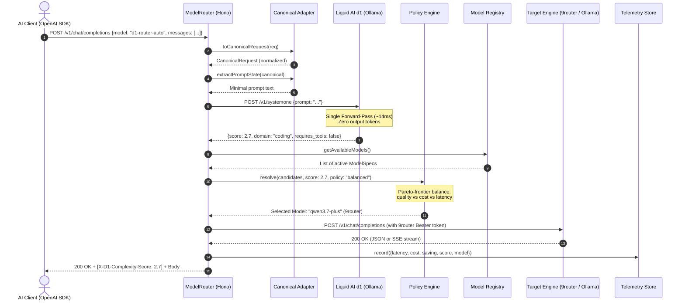
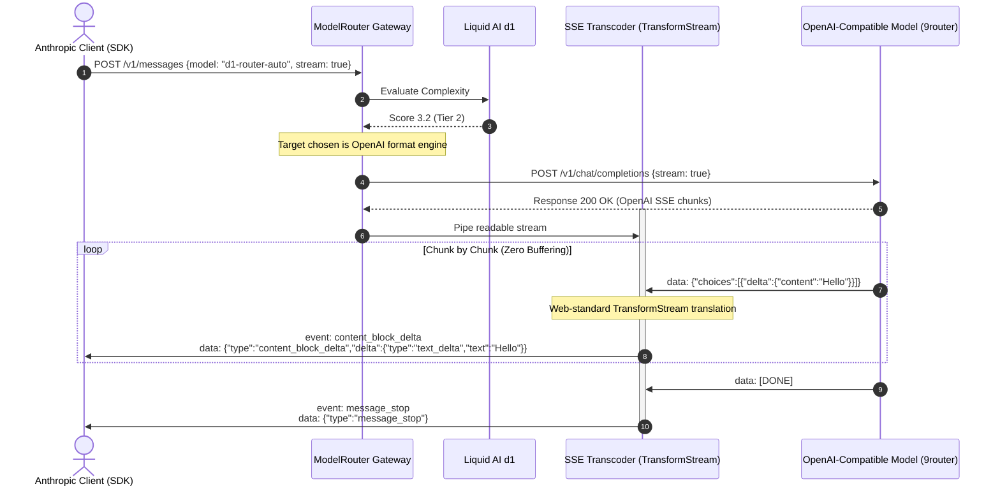
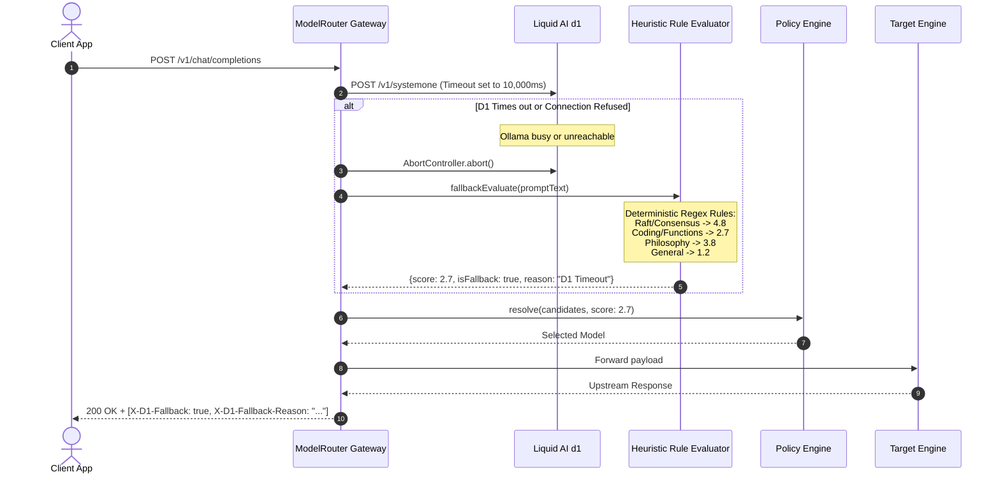
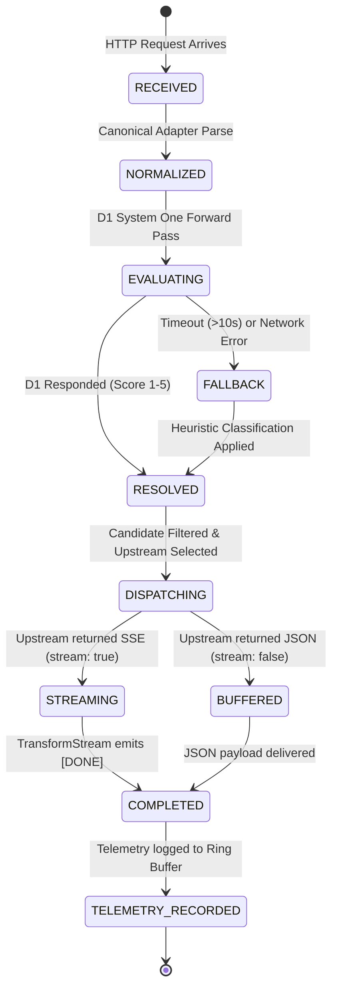

# Application Flow Document (AFD)
## ModelRouter — End-to-End System Logic & Process Flows

---

### Document Control
- **Document ID:** DOC-AFD-001
- **Product Name:** ModelRouter
- **Version:** 1.0.0
- **Status:** Approved / Production-Ready
- **Type:** Process & Architecture Flow Specification

---

## 1. High-Level System Flow Overview

The lifecycle of an inference request in ModelRouter proceeds through 5 deterministic, sequential stages:

```
┌────────────────────────────────────────────────────────────────────────┐
│                   STAGE 1: Ingress & Normalization                     │
│  Client sends request (OpenAI / Anthropic format) ──────────────────┐  │
│  Gateway parses body into zero-copy CanonicalRequest                │  │
│  Minimal instruction state extracted (prevents token bloat)         │  │
└───────────────────────────────────┬────────────────────────────────────┘
                                    │
                                    ▼
┌────────────────────────────────────────────────────────────────────────┐
│                   STAGE 2: Neural Decision Pass (d1)                   │
│  Query Ollama POST /v1/systemone (Zero output tokens generated)     │  │
│  10-second timeout guard with deterministic heuristic fallback     │  │
│  Output: Complexity score (1.00 - 5.00), Domain, Tools/Vision flags │  │
└───────────────────────────────────┬────────────────────────────────────┘
                                    │
                                    ▼
┌────────────────────────────────────────────────────────────────────────┐
│                   STAGE 3: Policy Resolution Filter                    │
│  Retrieve active models from ModelRegistry matching tags & ranges   │  │
│  Execute Policy: Balanced | Cost-Optimized | Quality-Max | Local-1st│  │
│  Select unique optimal upstream target model                        │  │
└───────────────────────────────────┬────────────────────────────────────┘
                                    │
                                    ▼
┌────────────────────────────────────────────────────────────────────────┐
│                   STAGE 4: Upstream Engine Dispatch                    │
│  Translate CanonicalRequest to target endpoint format               │  │
│  Inject credentials and upstream provider headers                   │  │
│  Dispatch fetch request to selected provider (Ollama / 9router)     │  │
└───────────────────────────────────┬────────────────────────────────────┘
                                    │
                                    ▼
┌────────────────────────────────────────────────────────────────────────┐
│                   STAGE 5: Stream Transcoding & Egress                 │
│  If streaming, transcode SSE event format on-the-fly via Web Streams│  │
│  Enrich response headers with X-D1 metadata                         │  │
│  Record telemetry into in-memory ring buffer (50 records)           │  │
└────────────────────────────────────────────────────────────────────────┘
```

---

## 2. Sequence Diagrams

### 2.1. Standard Inference Flow (Happy Path)



---

### 2.2. Bi-directional SSE Stream Transcoding Flow



---

### 2.3. Heuristic Fallback Flow (Resilience Path)



---

## 3. Finite State Machine (Request Lifecycle)

Each request transitioning through ModelRouter adheres to the following formal State Machine:



---

## 4. UI/UX Interaction Flows

### 4.1. Interactive Workbench (Playground) Execution Flow
1. **User Types or Selects Preset Prompt:**
   - Input textarea updates state. Client-side heuristic instantly previews tentative complexity.
2. **Click "Score Prompt":**
   - Calls `POST /api/evaluate`.
   - Liquid d1 evaluates complexity and returns full `DecisionEvaluation` object.
   - UI updates the Decision Flow Pipeline Graph (5 nodes) and calibrated Complexity Spectrum.
3. **Click "Route & Execute" (Streaming Mode):**
   - Dispatches `POST /v1/chat/completions` with `stream: true`.
   - Streaming token view renders in real-time with token counter, tokens/sec, and elapsed ms.
   - Fallback simulation activates if upstream API keys are unpopulated in local test environments.

### 4.2. Model Switchboard Management Flow
1. **View Model Fleet:**
   - User navigates to `/registry`. UI fetches `/api/registry/models`.
   - Displays all registered engines with complexity spans, cost/1M, provider badges, and capability chips.
2. **Toggle Active Status:**
   - User clicks `Active` / `Disabled` toggle switch.
   - Triggers `POST /api/registry/model/:id/toggle`.
   - Backend updates model in memory; subsequent inference requests automatically exclude disabled models.
3. **Register New Upstream Model:**
   - User clicks `Add Model`, enters ID, provider, upstream model name, complexity bounds `[min, max]`, and pricing.
   - Client validates fields and submits `POST /api/registry/models`. Model is appended to active fleet.

### 4.3. Real-Time Telemetry Polling Cycle
1. **Interval Trigger (Every 4,000ms):**
   - TanStack Router dashboard executes concurrent `fetch('/api/stats')` and `fetch('/api/telemetry/recent')`.
2. **State Refresh:**
   - `totalRequests`, `avgRoutingLatencyMs`, and `totalSavedUsd` counters re-render.
   - Complexity distribution bar graph updates (Local vs Mid-Tier vs Frontier).
   - Recent requests table prepends new entries with color-coded complexity pills and savings badges.
