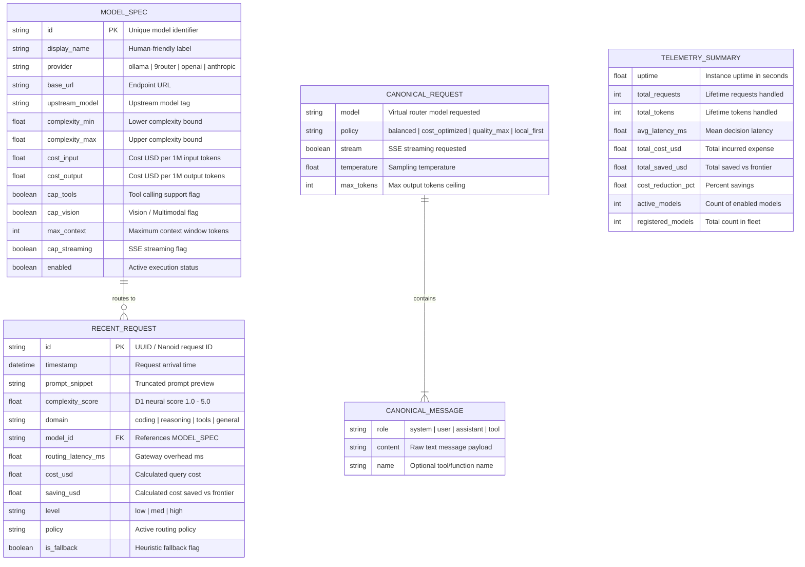

# Database & Data Model Design Document (DBD)
## ModelRouter — Data Schema, Storage Strategy & State Architecture

---

### Document Control
- **Document ID:** DOC-DBD-001
- **Product Name:** ModelRouter
- **Version:** 1.0.0
- **Status:** Approved / Production-Ready
- **Storage Strategy:** Declarative YAML Fleet + Memory Ring Buffer Store + Runtime Cache

---

## 1. Storage Strategy & Architectural Rationale

To maintain the sub-20ms P95 latency SLA, ModelRouter avoids blocking disk writes or synchronous RDBMS network calls during the request-routing hot path. The data layer is composed of three complementary storage mechanisms:

1. **Declarative Fleet Store (`config/registry.yaml`):**
   - Source of truth for model specifications, endpoints, capability flags, pricing metrics, and complexity ranges.
   - Loaded on startup via Zod validation, cached in memory, and editable at runtime via REST APIs.
2. **In-Memory Ring Buffer Store (`TelemetryStore` in `src/core/telemetry.ts`):**
   - Fixed-size bounded ring buffer (50 records) providing $O(1)$ push and retrieval for recent request telemetry without memory leaks or unbounded growth.
3. **Cumulative Metrics Counter State:**
   - In-memory atomic counters tracking total request count, processed tokens, cumulative cost, and frontier cost savings.

---

## 2. Entity-Relationship Diagram (ERD)



---

## 3. Data Dictionary & Detailed Schemas

### 3.1. Entity: `ModelSpec` (Fleet Registry)
Configured in `config/registry.yaml` and held in-memory via `ModelRegistry`:

| Field Name | Type | Constraints | Description |
| :--- | :--- | :--- | :--- |
| `id` | `String` | PK, Unique, Slug | Identifier used in routing decisions (e.g., `cloud-sonnet`). |
| `display_name` | `String` | Optional, Max 64 chars | Descriptive label displayed in UI (e.g., `Claude 3.5 Sonnet`). |
| `provider` | `Enum` | `ollama`, `openai`, `anthropic`, `openrouter`, `9router`, `custom` | Upstream provider protocol and client driver. |
| `base_url` | `String` | Valid URL | Target API endpoint (e.g., `http://localhost:11434/v1`). |
| `api_key_env` | `String` | Optional | Name of environment variable holding the upstream key. |
| `upstream_model`| `String` | Required | Actual model identifier passed to upstream API. |
| `complexity_range`| `Tuple[Float, Float]` | $1.0 \le \text{min} \le \text{max} \le 5.0$ | Continuous complexity window this model handles. |
| `cost.input_per_mtoken` | `Float` | $\ge 0.0$ | Rate in USD per 1,000,000 input tokens. |
| `cost.output_per_mtoken`| `Float` | $\ge 0.0$ | Rate in USD per 1,000,000 output tokens. |
| `capabilities.tools` | `Boolean` | Default: `false` | True if model natively supports function/tool calling. |
| `capabilities.vision` | `Boolean` | Default: `false` | True if model accepts image URLs / base64 payloads. |
| `capabilities.max_context` | `Integer` | $\ge 1024$ | Context window capacity (e.g., `128000`). |
| `capabilities.streaming` | `Boolean` | Default: `true` | True if model supports chunked SSE responses. |
| `tags` | `Array[String]` | Lowercase | Categorical tags (e.g., `["coding", "frontier"]`). |
| `enabled` | `Boolean` | Default: `true` | Controls whether the engine receives routed queries. |

### 3.2. Entity: `RecentRequest` (Telemetry Ring Buffer)
Held in `TelemetryStore.recentRequests` (Array capped at 50 entries):

| Field Name | Type | Description |
| :--- | :--- | :--- |
| `id` | `String` | Timestamp-based unique ID (e.g., `req-1730193482100-3`). |
| `time` | `String` | Human readable time string (e.g., `16:18:02`). |
| `timestamp` | `Number` | Epoch timestamp in milliseconds. |
| `promptSnippet` | `String` | First 80 characters of user prompt (sanitized). |
| `score` | `Float` | Liquid d1 evaluated complexity (e.g., `2.70`). |
| `domain` | `String` | Evaluated domain (`coding`, `general`, `analysis`). |
| `model` | `String` | Display name of selected upstream engine. |
| `modelId` | `String` | Unique ID of selected upstream engine. |
| `latency` | `String` | Decision latency formatted string (e.g., `14.2 ms`). |
| `saving` | `String` | Calculated cost savings vs frontier (e.g., `+$0.003`). |
| `savingUsd` | `Float` | Numerical savings in USD. |
| `costUsd` | `Float` | Incurred query cost in USD. |
| `level` | `Enum` | `'low'` ($< 2.0$), `'med'` ($2.0–3.5$), `'high'` ($> 3.5$). |
| `policy` | `String` | Routing policy applied (`balanced`, `quality_max`, etc.). |
| `isFallback` | `Boolean` | True if D1 timed out and heuristic fallback triggered. |

---

## 4. Ring Buffer Ingestion Algorithm

To guarantee fixed memory overhead regardless of query volume, `TelemetryStore` implements an in-memory Ring Buffer:

```typescript
export class TelemetryStore {
  private recentRequests: RecentRequest[] = [];
  private readonly MAX_RECENT = 50;

  record(event: TelemetryEvent): void {
    // 1. Calculate savings vs frontier baseline ($3.00 / 1M tokens)
    const frontierCost = (event.tokens / 1_000_000) * 3.00;
    const actualCost = (event.tokens / 1_000_000) * event.modelCostPerMToken;
    const savingUsd = Math.max(0, frontierCost - actualCost);

    // 2. Prepend new record
    this.recentRequests.unshift({
      id: `req-${Date.now()}-${Math.floor(Math.random() * 1000)}`,
      time: new Date().toLocaleTimeString(),
      timestamp: Date.now(),
      promptSnippet: event.prompt.slice(0, 80).replace(/\n/g, ' '),
      score: event.score,
      domain: event.domain,
      model: event.modelDisplayName,
      modelId: event.modelId,
      latency: `${event.latencyMs.toFixed(1)} ms`,
      saving: `+$${savingUsd.toFixed(4)}`,
      savingUsd,
      costUsd: actualCost,
      level: event.score < 2.0 ? 'low' : event.score < 3.5 ? 'med' : 'high',
      policy: event.policy,
      isFallback: event.isFallback,
    });

    // 3. Ring buffer eviction: truncate beyond MAX_RECENT
    if (this.recentRequests.length > this.MAX_RECENT) {
      this.recentRequests.length = this.MAX_RECENT;
    }

    // 4. Update atomic lifetime accumulators
    this.totalRequests++;
    this.totalTokens += event.tokens;
    this.totalCostUsd += actualCost;
    this.totalSavedUsd += savingUsd;
  }
}
```

---

## 5. Future Persistence Scaling (PostgreSQL / ClickHouse Migration Path)

If long-term enterprise audit trails, SOC2 compliance, or team billing breakdowns are required:

1. **ClickHouse or SQLite for Cold Telemetry:**
   - Flush `RecentRequest` batches asynchronously to ClickHouse / SQLite using an in-memory queue.
   - Hot path continues to read from the memory ring buffer; cold analytical queries hit the database.
2. **PostgreSQL for Multi-Tenant Fleet Configurations:**
   - Migrate `ModelSpec` to a relational `models` table with tenant isolation (`tenant_id`, `created_at`, `updated_at`).
   - Store API keys in HashiCorp Vault or AWS KMS rather than `.env` variables.
